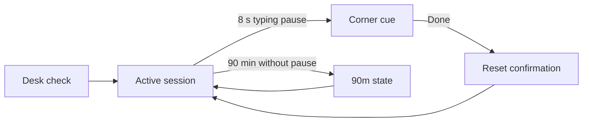

<!--@slide Opening-->
# CornerCue: a posture reminder that does not interrupt your focus

Can a posture reminder protect your neck and back without costing you your concentration?

---

<!--@slide The problem-->
# The problem

- Long evening laptop sessions: posture slumps without being noticed
- Fixed timers and popups break deep focus (about ten minutes lost)
- Reminders get dismissed, or the tool gets deleted
- Evidence base: one interview and one timer audit, so these are hypotheses

---

<!--@slide Research-->
# What I learned

- Interview (1 student): breaks happen at natural pauses, not at fixed times
- Audit of the Morgen Pomodoro timer: six findings
- Keyboard keys did not respond, a promo card added clutter, settings were one long scroll

---

<!--@slide Direction-->
# Chosen direction

- Show a cue only during a typing pause
- Respond with one key: Done `Enter`, Snooze `Space`, Dismiss `Esc`
- Dark mode, text and icon together
- Optional 30-second desk check before a session
- Left out: webcam tracking, calendars, sound mixers

---

<!--@slide Main flow-->
# The main flow

---

<!--@slide Usability test-->
# Usability test: 3 students

- Cue button found within about 2 seconds
- Confirmation screen visible only about 1.8 seconds
- All 3 doubted that the reset was saved
- The 90-minute state had no buttons, so all 3 hesitated or clicked outside the card

---

<!--@slide Iterations-->
# What I changed

- Confirmation shown for 2800 ms, plus a persistent `Last posture reset: just now`
- Buttons `Take stretch break` and `Dismiss` on the 90-minute state
- Caption `Triggered during 8s typing pause` on the cue
- Mini design system: buttons, checkbox row, prompt card

---

<!--@slide Limits-->
# Limits

- Only 3 participants
- Typing pause is simulated in Figma
- Changes checked by self-walkthrough only
- Confidence ratings were not collected

---

<!--@slide Takeaway-->
# Show the cue at a natural pause, and always confirm the action

Next step: validate the changes with 3 more participants.
